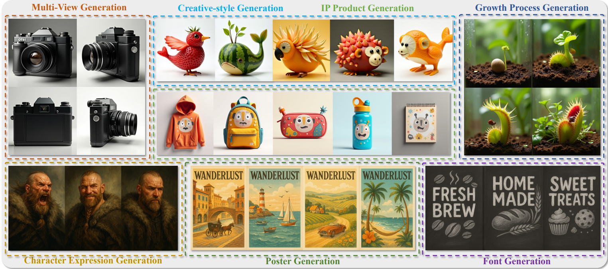

<h1 align="center">
Why Settle for One? Text-to-ImageSet Generation and Evaluation
</h1>
<p align="center">
  <a href="https://chengyou-jia.github.io/T2IS-Home/"><b>[🌐 Website]</b></a> •
  <a href="https://arxiv.org/abs/2506.23275"><b>[📜 Paper]</b></a> •
  <a href="https://huggingface.co/datasets/ChengyouJia/T2IS-Bench"><b>[🤗 HF Dataset]</b></a> •  
</p>


<p align="center">
Official Repo for "<a href="https://arxiv.org/abs/2506.23275" target="_blank">Why Settle for One?
Text-to-ImageSet Generation and Evaluation</a>"
</p>

<!-- > **🚀 Code for ~~evaluation~~ and generation will be released soon. Stay tuned!**  
> We are working hard to make the code available. Watch this repo for updates! -->

## T2IS



##  News

- _2025.09_: We release the <a href="https://github.com/chengyou-jia/T2IS/tree/main/T2IS_Gen"><b>[T2IS-Gen]</b></a> simple version of set-aware generation code.


- _2025.08_: We release the <a href="https://github.com/chengyou-jia/T2IS/tree/main/T2IS_Eval"><b>[T2IS-Eval]</b></a> evaluation toolkit.
- _2025.07_:  We release the details of <a href="https://huggingface.co/datasets/ChengyouJia/T2IS-Bench"><b>[T2IS-Bench]</b></a>.


## 🛠️ Installation

### Text-to-ImageSet Generation

### 1. Set Environment
```bash
conda create -n T2IS python==3.9
conda activate T2IS
pip install xformers==0.0.28.post1 diffusers peft torchvision==0.19.1 opencv-python==4.10.0.84 sentencepiece==0.2.0 protobuf==5.28.1 scipy==1.13.1
```

### 2. Quick Start

```bash
cd T2IS_Gen
```

```python
import torch
import argparse
import json
import os
from t2is_pipeline_flux import T2IS_FluxPipeline
from PIL import Image
from utils import calculate_layout_dimensions, calculate_cutting_layout
pipe = T2IS_FluxPipeline.from_pretrained("/home/chengyou/hugging/models/FLUX.1-dev", torch_dtype=torch.bfloat16)
pipe = pipe.to("cuda")

# base_output_path = "../output_images/RAG_layout_deepseek-reasoner_3_30_seed_1234"
base_output_path = "./output_images/"

print(f"Processing file with task name case ID: 0001_0007")
task_name_case_id = "dynamic_character_scenario_design_0007"
Divide_prompt_list = [
    "The boy stands at a science fair, surrounded by project displays and glowing holographic models. He holds a blueprint, his expression bright with curiosity. The background features blurred crowds and colorful experiment stations under bright indoor lighting.",
    "The boy crouches in a sunlit garden, digging soil with a trowel. Dirt stains his hands and casual clothes, with scattered gardening tools nearby. His focused gaze and slightly parted lips suggest discovery, sunlight casting sharp shadows on the earthy textures.",
    "The boy wears a green knitted hat in a snowy urban park, breath visible in cold air. Frosted trees frame the scene as he clutches a steaming drink. The hat's yarn details contrast with his spiky hair, while distant ice-skating figures blur into the winter haze."
]
prompt = "THREE-PANEL Images with a 1x3 grid layout a teenage boy with short spiky black hair, a slight build, and dark brown eyes in hyper-realistic style.All images maintain hyper-realistic digital painting style with consistent character design, emphasizing the boy's distinct features and naturalistic lighting across varied environments. [LEFT]:The boy stands at a science fair, surrounded by project displays and glowing holographic models. He holds a blueprint, his expression bright with curiosity. The background features blurred crowds and colorful experiment stations under bright indoor lighting. [MIDDLE]:The boy crouches in a sunlit garden, digging soil with a trowel. Dirt stains his hands and casual clothes, with scattered gardening tools nearby. His focused gaze and slightly parted lips suggest discovery, sunlight casting sharp shadows on the earthy textures. [RIGHT]:The boy wears a green knitted hat in a snowy urban park, breath visible in cold air. Frosted trees frame the scene as he clutches a steaming drink. The hat's yarn details contrast with his spiky hair, while distant ice-skating figures blur into the winter haze."

# Set default sub-image size to 512x512
sub_height = 512
sub_width = 512

# Calculate total height and width based on layout
num_prompts = len(Divide_prompt_list)
height, width = calculate_layout_dimensions(num_prompts, sub_height, sub_width)


Divide_replace = 2
num_inference_steps = 20

seeds = [1234]

for seed_idx, seed in enumerate(seeds):
    seed_output_path = os.path.join(base_output_path, f"seed_{seed}")
    if not os.path.exists(seed_output_path):
        os.makedirs(seed_output_path)
        
    print(f"Generating with seed {seed}:")
    try:
        image = pipe(
            Divide_prompt_list=Divide_prompt_list,
            Divide_replace=Divide_replace,
            seed=seed,
            prompt=prompt,
            height=height,
            width=width,
            num_inference_steps=num_inference_steps,
            guidance_scale=3.5,
        ).images[0]
    except Exception as e:
        print(f"Error processing {idx} with seed {seed}: {str(e)}")
        continue
    image.save(os.path.join(seed_output_path, f"{idx}_merge_seed{seed}.png"))
```
## Generated ImageSet
<summary>Examples</summary> 
<table class="center">
  <tr>
    <td width=100% style="border: none"></td>
  </tr>
</table>


## Citation
If you find it helpful, please kindly cite the paper.
```
@article{jia2025settle,
  title={Why Settle for One? Text-to-ImageSet Generation and Evaluation},
  author={Jia, Chengyou and Shen, Xin and Dang, Zhuohang and Xia, Changliang and Wu, Weijia and Zhang, Xinyu and Qian, Hangwei and Tsang, Ivor W and Luo, Minnan},
  journal={arXiv preprint arXiv:2506.23275},
  year={2025}
}
```

## 📬 Contact

If you have any inquiries, suggestions, or wish to contact us for any reason, we warmly invite you to email us at cp3jia@stu.xjtu.edu.cn.
